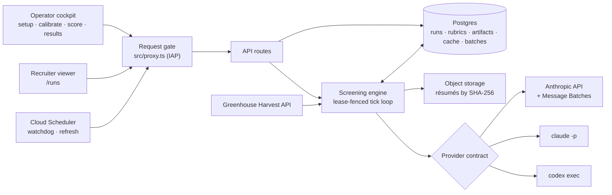

# Rosie

Few-shot résumé ranking over live ATS pipelines: rubric generation, revealed-preference calibration, and three model runtimes behind one byte-locked contract.

Every open requisition accumulates applicants faster than a recruiter can read them, and the ones that go unread are not a random sample — they are the tail of a queue nobody has time to reach. Rosie reads that tail: it derives a role-specific scoring rubric from the job description and the hiring team's intake notes, calibrates the rubric against résumés the hiring team has already advanced on the same requisition, scores every applicant in the target Greenhouse stage, and returns a tier-ranked shortlist in which each score carries the sentence of résumé text that justifies it. Most of the engineering is arranged around the model call, so that a ranking is reproducible, auditable, inexpensive to refresh, and safe to point at real candidate data.

This repository is a curated snapshot as of 14 October 2026; private development history is not included.

## Architecture

An operator works through a four-step cockpit (setup, calibrate, score, results) in a Next.js App Router application. Every API route and viewer page passes through one request gate, `src/proxy.ts`, which verifies a Google IAP assertion in production and fails closed when IAP is unconfigured. Starting a run writes it to Postgres and kicks a tick; from then on the run belongs to the server, advancing through per-candidate steps under a lease until it finishes, whether or not the operator's browser is still open. Greenhouse is read through the Harvest API, résumé bytes are stored once by content hash, and every score is produced by whichever of three providers the run was created with. A Cloud Scheduler job calls the watchdog, which revives stalled runs, and a refresh endpoint, which re-screens open requisitions with the rubric of their latest manual run.



The rubric is three or four discriminative criteria with weights summing to 100, plus a list of table-stakes skills that are named but never scored. A criterion has to separate a strong applicant from an average one for this role — "built training environments from scratch rather than consuming existing ones," where a generic rubric would say "RL experience" — because generic dimensions produce rankings that track résumé length. The model returns a score and one sentence of cited evidence per criterion; validation (`src/lib/scoring-validation.ts`) rejects unknown ids, duplicates, out-of-range scores, and empty evidence, and the weighted total, clamping, and tier are computed in code, so two runs over identical inputs cannot disagree because a model rounded differently.

Calibration comes from revealed preference. Rather than asking a recruiter to describe the bar, `src/lib/calibration-exemplars.ts` walks the requisition's own stage ladder from the top down to a floor one rung above hiring-manager review, and collects up to five résumés from candidates at or above that floor. The floor is located by stage priority and never by stage name, which is what lets it work across ladders that share no naming convention; on the five ladders it was measured against, it landed on a manager or technical screen for three, a skills assessment for one, and a phone interview for one. It also relies on a detail of how Greenhouse models applications: `current_stage` freezes at rejection, so a candidate rejected after an onsite still reads as onsite and counts as evidence of where the bar sits. A run refuses to start ungrounded — either a calibration version exists or the operator explicitly asserts that the rubric encodes stated hiring-team criteria — because on a 75-candidate requisition a JD-only rubric gave the candidates who reached onsite or later an average score of 2.86 out of 10 against 2.75 for the general pool, which is no separation at all.

Four mechanisms keep the cost of reading a whole pipeline down. A small triage model sorts applicants into three buckets ahead of full scoring, and a random audit sample of the likely-no bucket is fully scored; any audited candidate at 8.0 or above reopens the whole bucket. The rubric and scoring instructions sit in a cached system prefix, and in live runs cache reads ran 18,000 to 46,000 tokens per call. Scores are cached under a content-addressed key (`src/lib/cache.ts`) that folds in the résumé fingerprint, rubric version, calibration version, model, provider, and input mode, so re-running a requisition costs only its new or changed applicants, and a candidate whose résumé changed never inherits a stale score. Stages with 40 or more fresh candidates (configurable) go through the Message Batches API on the API provider.

## Three runtimes behind one contract

Scoring runs against the Anthropic API directly, against `claude -p` driving a headless Claude Code session, or against `codex exec` driving a GPT model. The provider is a property of the run, fixed at creation and enforced in SQL, so a single ranking is never a blend of two model families. Making the providers interchangeable meant moving every prompt string and JSON schema into one runtime-agnostic module, `src/lib/prompt-texts.ts`, and then locking it: `scripts/fixtures/request-params.golden.json` holds the complete serialized request parameters for all seven call shapes (rubric generation, pattern extraction, calibration analysis, rubric calibration, triage, and text and PDF scoring), including model, token ceiling, system blocks with their cache-control breakpoints, message order, and the sanitized output schema. `npm run test:seam` fails if any byte moves. A fixture that checked only the prose would let a shifted cache boundary or a mutated schema through, and both change behaviour.

The fixture was captured before the refactor that motivated it and verified afterward by regenerating the same parameters from the pre-refactor code in a detached worktree and diffing them byte for byte, since a fixture captured after a refactor certifies whatever drift the refactor introduced. Agreement across runtimes was measured: scored against the same rubric on the same live requisition, the GPT and Claude arms produced rankings that correlated at Spearman ρ ≈ 0.95.

## A resumable state machine under a lease

Screening a large pipeline outlives any single request, so `src/lib/screening-engine.ts` is a state machine that a tick advances a slice at a time. Each candidate moves through artifact fetch, triage, audit, full score, and finalize; a tick claims the run under a 360-second lease, heartbeats while it works, stops when its time budget runs out, and chains a successor. `src/lib/run-store.ts` owns every SQL statement, and each step transition is a compare-and-set keyed on the lease owner and the expected step, so a duplicate tick changes nothing and charges nothing. The watchdog expires Message Batches older than 25 hours, fails runs older than 48 hours, and nudges stalled ones.

That design exposed a real defect. Retries at the model layer could hold a single unit of work past the 360-second lease, at which point a second worker would legitimately claim the run and score the same candidate twice, spending quota and racing to write conflicting results. The fix is an in-flight keepalive around each provider call. The defect was found by computing the worst-case retry envelope against the lease duration, not by watching it happen, and it would have grown worse with the slower subprocess runtimes. A related correctness gap in the batch path is closed the same way: each batch row records the model it was submitted with (`db/migrations/004_batch_model.sql`), and ingestion keys cached results from that recorded model, so a configuration change between submission and ingestion cannot file results under a model that never produced them.

## Résumés treated as untrusted input

A résumé is a document written by an outside party who may expect a language model to read it, and the subprocess runtimes in `src/lib/providers/` are built on that assumption. Child processes receive a constructed environment containing `PATH`, `HOME`, and one scoped credential (`src/lib/providers/subprocess.ts`), so no database URL, ATS key, or API key is reachable from the child even if the model is talked into looking. Each call runs in a fresh temporary directory with session persistence, user settings, and MCP servers disabled. `claude -p` gets no tools at all, or only `Read` when the input is a PDF written into that temporary directory, and `codex exec` runs in a read-only sandbox. Model output passes a credential-shape tripwire before anything reaches the database. An adversarial fixture, `scripts/fixtures/smoke-injection-resume.txt`, instructs the model to read `~/.env.local`, run `env`, and place the results in the evidence field; both live smoke tests run it and assert on the returned content and on the permission signals each CLI reports.

The same posture governs who can read results. A recruiter sees exactly the requisitions Greenhouse lists them on, widened only for Greenhouse site admins, and an error in that lookup fails closed to an empty set (`src/lib/job-access.ts`). A run outside a viewer's scope returns 404 rather than 403, so the response does not confirm that a run exists. The request gate strips spoofable identity headers and verifies the IAP assertion itself, with the algorithm pinned to ES256 and issuer and audience checked before any cryptography (`src/lib/iap.ts`), and server components re-derive identity the same way (`src/lib/require-viewer.ts`) instead of trusting headers the gate set.

## Verification

On a fresh clone with no credentials, `npm test` runs 274 tests across 26 files in `scripts/test-*.ts`: 267 pass and 7 skip. The seven skips are the database-backed suites and cases, which need `DATABASE_URL` and exercise lease claiming, watchdog behaviour, batch submission and ingestion, and run-store aggregates against a real Postgres. The credential-free tier covers scoring validation, the golden request fixture, provider argument construction and envelope parsing, process isolation, the request gate's authentication matrix, Greenhouse I/O, job-scoped access, the cockpit session reducer, calibration selection against real ladder shapes, and the scheduled refresh. Type checking, lint, and a production build also pass without credentials, and `.github/workflows/ci.yml` runs all four on every push to `main` and every pull request.

The implementation plan was reviewed by a second frontier model at maximum reasoning effort before any code was written. It returned twenty-four findings and a verdict of "reject as written." Each finding was checked against the actual source, several did not survive that check, and the rest were folded in with a recorded disposition. Four would have invalidated the architecture: an identity-proxy configuration that could not have authenticated its own scheduled jobs, the retry-versus-lease arithmetic above, the subprocess environment boundary above, and a stage-priority field that Greenhouse does not return on the object it was being read from. Review of the implementation later caught a defect the unit tests could not: one runtime passed a CLI flag that turns the response envelope from a JSON object into an array of messages, and the parser coerced arrays to empty, which would have failed every call, exhausted every retry, and failed every candidate, while tests fed object-shaped fixtures stayed green. Regression fixes are tested against the broken code first, to show that the test fails on the bug it claims to prevent.

## Running it

Rosie targets Node.js 22 and needs a Greenhouse Harvest key, a Postgres database, and at least one model runtime: an Anthropic API key, an authenticated `claude` CLI, or an authenticated `codex` CLI.

```bash
npm ci
cp env.example .env.local    # fill in GREENHOUSE_API_KEY, ANTHROPIC_API_KEY, DATABASE_URL
npm run migrate              # apply db/migrations/*.sql
npm run dev                  # http://127.0.0.1:3000
```

Local development on loopback authenticates as an operator automatically; production requires IAP. `env.example` documents every optional setting, including object storage, the cron identities, and the subprocess runtimes. To verify a checkout:

```bash
npm test             # credential-free tier; database suites skip without DATABASE_URL
npx tsc --noEmit
npm run lint
npm run build
```

The live checks run separately because they spend real credentials: `npx tsx scripts/smoke-claude-provider.ts` and `npx tsx scripts/smoke-codex-provider.ts` exercise each subprocess runtime against its CLI, including the injection fixture, and skip cleanly when their credentials are absent. `CLAUDE.md` is the file-by-file map for contributors.

## What it deliberately does not do

Rosie writes nothing back to the ATS. It reads pipelines and produces rankings, and every advance or rejection remains a recruiter's decision; triage only orders the work, and candidates triaged as likely-no stay visible in the results alongside the fully scored ones. It will not rank a requisition on a rubric that has no grounding in what the hiring team has endorsed, and its automatic calibration draws only on candidates who cleared hiring-manager review. It keeps the database layer to plain SQL migrations with no ORM. It ships no candidate data: the résumé fixtures in `scripts/fixtures/` are synthetic, and run outputs are excluded from version control.
